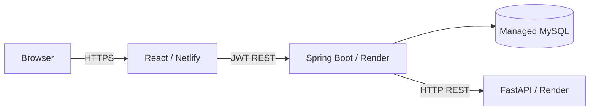
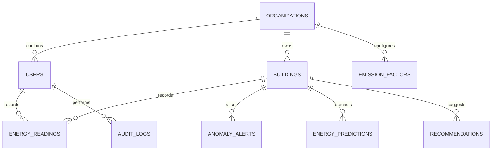

# GreenPulse

GreenPulse is an energy and carbon intelligence platform for organizations and building operators. It combines a React dashboard, a Spring Boot REST API backed by MySQL, and a Python forecasting and anomaly service.

## Current implementation

- React + Vite + TypeScript dashboard with login, protected routes, readings, analytics, predictions, anomalies, carbon, and recommendations views.
- Spring Boot API with JWT authentication, organization/building scoping, persistent energy readings, CSV import, dashboard/trend/carbon endpoints, and configurable emission factors.
- FastAPI service with chronological time-series evaluation, Linear Regression and Random Forest forecasting, and Isolation Forest anomaly detection.
- MySQL schema migration, Swagger UI, Render deployment config, Netlify SPA routing, environment examples, Postman collection, and diagrams.

This workspace has no Java/Maven or Node/npm installed, so those builds cannot be run here. Python 3.13 is present. No external database, deployed credentials, or public dataset is bundled. The services are configured for provider-independent external MySQL. The ML service accepts real readings from the API and does not claim metrics until it trains on supplied data.

## Architecture





## Layout

```text
frontend/                 React/Vite UI and Netlify config
backend/                  Spring Boot API, Dockerfile, Flyway migration
ml-service/               FastAPI training, prediction, anomaly APIs
docs/                     ML, deployment, API notes
postman/                  API collection
```

## Local setup

Prerequisites: Java 17+, Maven 3.9+, Node 20+, Python 3.11+, MySQL 8+. No Docker Compose is required.

1. Create a MySQL database and user. Set the variables listed in `.env.example` and the service-specific examples. Flyway applies `backend/src/main/resources/db/migration/V1__initial_schema.sql` at startup.
2. Start ML: `cd ml-service && python -m venv .venv && . .venv/bin/activate && pip install -r requirements.txt && uvicorn app.main:app --reload --port 8001`.
3. Start API: `cd backend && mvn spring-boot:run`.
4. Start UI: `cd frontend && npm install && npm run dev`.

Configure a first administrator directly using `POST /api/v1/auth/register` only while `ALLOW_REGISTRATION=true`; set an organization id and role in the request. Disable public registration after setup. An initial global emission factor can be added as an ORG_ADMIN. This codebase does not seed fake reading data.

## Environment

See root `.env.example`, `frontend/.env.example`, `backend/.env.example`, and `ml-service/.env.example`. Never commit real values. In production use a long random JWT secret, TLS database URL, and explicit allowed frontend origin. Render supplies `PORT`.

## Database model

The Flyway migration creates organizations, users, buildings, building assignments, energy readings (unique per building/day), emission factors, anomaly alerts, predictions, recommendations, and audit logs with indexes and foreign keys. Organization boundaries are enforced in services for the authenticated principal; building managers also need an assignment.

## API

Base path `/api/v1`; success payload `{success,message,data,timestamp}`. OpenAPI UI at `/swagger-ui/index.html` and schema at `/v3/api-docs`.

| Area | Endpoints |
|---|---|
| Auth | `POST /auth/register`, `POST /auth/login`, `GET /auth/me`, `POST /auth/refresh` |
| Organizations/buildings | Organization list/detail/create; building list/detail/create; organization building listing |
| Readings | Create/list, building history, multipart `/energy-readings/upload` |
| Analytics | dashboard, consumption trends, building comparison, monthly summary, distribution |
| Carbon | emissions, monthly summary, comparison, emission factor CRUD |
| ML/insights | anomalies, predictions, recommendations and generation endpoints |

Update/delete endpoints for organizations, buildings and readings, user administration, and audit event writing are not implemented yet. The schema includes audit logs and building assignments, but no management workflow populates them. Treat this build as a functional initial release foundation, not as the finished enterprise scope from the original brief.

See `postman/GreenPulse.postman_collection.json`. Swagger describes the deployed API.

## Security and roles

JWT bearer tokens, BCrypt passwords, Spring method authorization, organization scoping, and building assignment checks. Roles: SUPER_ADMIN, ORG_ADMIN, BUILDING_MANAGER, ANALYST. Public registration is off by default. Super admins can span organizations; other users are scoped to their organization.

## ML and data

The service implements Linear Regression baseline, Random Forest primary model, chronological holdout evaluation (MAE/RMSE/R²), lag and calendar features, and Isolation Forest anomaly scores. It requires sufficient observed readings; no fabricated metrics or readings are supplied. The original-data ingestion path is CSV upload; select a public dataset such as UCI Individual Household Electric Power Consumption only after reviewing its current license/terms and document the chosen dataset and preprocessing provenance before using it. See `docs/ML.md`.

The default model storage path is local and ephemeral. Configure durable storage or retrain after Render redeploy; this application does not assume persistence on Render's temporary filesystem.

## Reports

The frontend report view exports the currently loaded readings to CSV. XLSX/PDF generation is not included yet.

## Deployment

### Netlify

Connect the repository, set base directory `frontend`, build command `npm run build`, publish directory `dist`, and environment variable `VITE_API_BASE_URL=https://<your-api>.onrender.com/api/v1`. `frontend/netlify.toml` rewrites SPA routes. Deploy without Docker.

### Render Spring Boot

Create a Docker Web Service from the repository with root directory `backend` and Dockerfile `Dockerfile`. Set `SPRING_PROFILES_ACTIVE=prod`, `DB_HOST`, `DB_PORT`, `DB_NAME`, `DB_USERNAME`, `DB_PASSWORD`, `JWT_SECRET`, `CORS_ALLOWED_ORIGIN`, and `ML_SERVICE_URL`. Configure health check `/actuator/health`. The image binds `0.0.0.0:$PORT`.

### Render FastAPI

Create a native Python Web Service with root `ml-service`, build command `pip install -r requirements.txt`, start command `uvicorn app.main:app --host 0.0.0.0 --port $PORT`. Set `MODEL_DIR` to a durable mounted path if available; otherwise retrain after deploy. Configure `BACKEND_SHARED_SECRET` only if enabled by your deployment policy.

### Managed MySQL

Provision MySQL 8 at a managed provider. Create a least-privilege application user and schema, require TLS when supported, and configure the DB variables in Render. The JDBC URL enables TLS when `DB_SSL=true`. Flyway creates the schema at first API start. Verify `/actuator/health` reports database connectivity.

## Verification

Python unit tests live under `ml-service/tests`; run `cd ml-service && pip install -r requirements.txt && pytest`. Backend: `cd backend && mvn test package`. Frontend: `cd frontend && npm install && npm run build`. The current execution environment lacks Node/npm, Java, and Maven, and dependency network access was not established, so those builds remain unverified here.

## Future work

- XLSX and PDF reports.
- User/building assignment administration UI.
- Refresh-token rotation and invitation-based account provisioning.
- Durable model registry and automated retraining schedule.
- Real deployment smoke checks and integration tests with a managed MySQL instance.

## Screenshots

Run the UI locally to capture environment-specific screenshots; no screenshots are committed yet.
